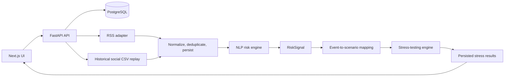
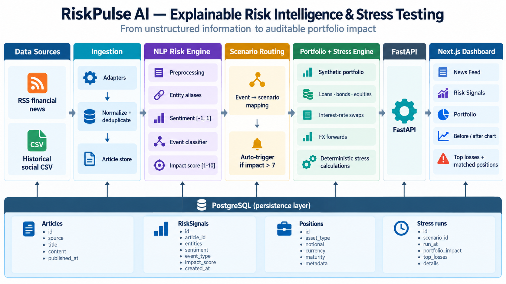

# RiskPulse AI - S&P Global & Crisil Campus Hackathon

**Candidate Name:** Amit Kumar<br>
**College Email ID:** cs23b1004@iiitr.ac.in<br>
**College / Campus:** Indian Institute of Information Technology Raichur (IIIT Raichur)<br>
**Demo Video Link:** [Add unlisted YouTube link]<br>
**Slide Deck Link:** [Add hosted slide-deck link, if available]<br>

RiskPulse AI is a financial risk intelligence and portfolio stress-testing prototype. It converts financial news and historical social posts into traceable risk signals, maps those signals to a synthetic portfolio, and runs deterministic scenario analysis when a signal is material.

The system is designed for an analyst demo rather than live trading or credit underwriting. Every signal keeps its source article, extracted entities, sentiment, event classification, impact factors, and model metadata. Stress results preserve the triggering signal, scenario assumptions, position-level calculations, and reconciliation details.

## 1. Project Overview / Problem Statement & Approach

Financial risk teams need to move from unstructured information to an explainable view of portfolio impact. News and social content can contain early indications of credit deterioration, geopolitical stress, regulatory action, market disruption, or other events, but raw text alone is not an auditable risk assessment.

RiskPulse AI addresses this with a pipeline that ingests RSS news and a historical social CSV, normalizes and deduplicates records, extracts known entities through aliases, scores sentiment, classifies event type, and assigns an impact score from 1 to 10. A signal above the configured threshold automatically selects the matching scenario and runs a targeted or broad portfolio stress test.

The demo portfolio contains named Tesla, Apple, Microsoft, and HDFC Bank exposures across loans, bonds, and equities, plus interest-rate swaps and FX forwards. The stress-testing view compares portfolio value before and after the scenario, shows asset-class changes, highlights the five largest losses, and lists the matched positions.

## 2. Architecture & Tech Stack



The detailed notes are in [`docs/architecture.md`](docs/architecture.md).



### Technology stack

- Backend: Python 3.12+, FastAPI, SQLAlchemy, Alembic, Pydantic Settings, Uvicorn
- Database: PostgreSQL 16 through Docker Compose
- Frontend: Next.js 15, React 19, TypeScript, Recharts
- NLP: deterministic heuristic sentiment by default; optional FinBERT adapter
- Testing: pytest, mocked provider/model boundaries, ESLint, TypeScript checks
- License: MIT ([`LICENSE`](LICENSE))

### Current repository structure

```text
RiskPulseAi/
├── README.md
├── LICENSE
├── docker-compose.yml
├── data/
│   └── transactions.csv
├── backend/
│   ├── app/                 # FastAPI application, ingestion, NLP, portfolio, stress engine
│   ├── data/                # Demo articles, aliases, portfolio seed, social CSV
│   ├── migrations/          # Alembic schema and data migrations
│   ├── tests/
│   └── requirements*.txt
├── frontend/
│   ├── app/                 # Next.js routes and pages
│   ├── components/
│   └── lib/
├── scripts/
│   └── build_portfolio.py
└── docs/                    # API, NLP, portfolio, research, and stress-test notes
```

## 3. Dataset Used

- `data/transactions.csv`: a local transaction export with date, description, amount, transaction type, category, and account fields. The portfolio builder groups recurring and category patterns into clearly labelled synthetic exposure proxies. Transactions are not treated as proof of actual loans, bonds, equities, or derivatives.
- `backend/data/tweets-vs-stock.csv`: a historical Tweet Sentiment's Impact on Stock Returns export with date, tweet, stock, and company fields. It is replayed as `source="social"` through the same normalization, deduplication, article persistence, NLP, and stress-trigger flow as other sources.
- `backend/data/demo_articles.json`: deterministic demo articles, including two high-impact named-company articles for the automatic stress-test demonstration.
- `backend/data/entity_aliases.json`: explicit aliases for supported organizations and tickers, including Tesla, Apple, Microsoft, and HDFC Bank.
- `backend/data/portfolio_seed.json`: synthetic portfolio seed with corporate loans, bonds, equities, interest-rate swaps, and FX forwards.

The CSV files are local/user-supplied data and are not redistributed as a claim of ownership. Retain the original dataset attribution and verify its terms before public redistribution.

## 4. Quickstart & Installation

### Runtime

- Python 3.12+; verified locally with Python 3.14.2
- Node.js 20+
- Docker Desktop with Compose
- Tested on Windows PowerShell; equivalent shell commands work on macOS/Linux with path syntax adjusted.

### Step-by-step local setup (Bash)

The repository keeps backend dependencies in `backend/requirements.txt` and frontend dependencies in `frontend/package.json`.

```bash
git clone <your-repo-url>
cd <repo-folder>

cp .env.example .env
cp frontend/.env.example frontend/.env.local
docker compose up -d postgres

python3 -m venv backend/.venv
source backend/.venv/bin/activate
python -m pip install -r backend/requirements.txt

cd backend
alembic upgrade head
python -m app.db.seed
uvicorn app.main:app --reload --host 0.0.0.0 --port 8000
```

In a second terminal, from the repository root:

```bash
cd <repo-folder>/frontend
npm install
npm run dev
```

Open <http://localhost:3000> for the frontend and <http://localhost:8000/docs> for the API documentation.

### Start PostgreSQL and the backend

```powershell
Copy-Item .env.example .env
Copy-Item frontend/.env.example frontend/.env.local
docker compose up -d postgres

Set-Location backend
python -m venv .venv
.\.venv\Scripts\Activate.ps1
python -m pip install -r requirements.txt
alembic upgrade head
python -m app.db.seed
uvicorn app.main:app --reload --host 0.0.0.0 --port 8000
```

### Start the frontend

In a second terminal:

```powershell
Set-Location frontend
npm install
npm run dev
```

Open <http://localhost:3000> for the application and <http://localhost:8000/docs> for the API documentation.

### Run the deterministic demo

```powershell
Invoke-RestMethod -Method Post http://localhost:8000/ingestion/demo
Invoke-RestMethod -Method Post -Uri http://localhost:8000/nlp/process-pending -ContentType application/json -Body '{"limit":25}'
```

Open the Stress Testing page and inspect the newest automatic run. The named-company demo articles should produce impact scores above 7 and show the triggering article and matched portfolio positions.

### Replay the historical social dataset

The News Feed page provides bounded replay controls. The equivalent API commands are:

```powershell
Invoke-RestMethod -Method Post -Uri http://localhost:8000/replay/start -ContentType application/json -Body '{"speed_records_per_second":1,"batch_size":1}'
Invoke-RestMethod http://localhost:8000/replay/status
```

The replay stores historical publication time separately from ingestion time. It is not a live social feed and the CSV does not provide market-return labels used by the risk engine.

### Build the synthetic portfolio from transactions

```powershell
python scripts/build_portfolio.py --input data/transactions.csv
Set-Location backend
alembic upgrade head
python -m app.db.seed
```

See [`docs/portfolio.md`](docs/portfolio.md) for the mapping assumptions.

### Optional FinBERT demo

The safe default is heuristic sentiment. To use FinBERT:

```powershell
Set-Location backend
python -m pip install -r requirements-finbert.txt
$env:NLP_SENTIMENT_BACKEND="finbert"
$env:NLP_ALLOW_MODEL_DOWNLOAD="true"
python -m app.nlp.process --limit 25
```

The model download requires network access. Tests use the heuristic backend by default.

## 5. Key Results & Domain Impact

- Two-source ingestion with normalization, source isolation, bounded retries, and content-hash deduplication.
- Sentiment stored as one score in `[-1, 1]`, with the label and class probabilities retained as supporting metadata.
- Impact scoring on a 1-10 scale with an explanation containing sentiment magnitude, event-type weight, and entity exposure.
- Automatic stress testing for qualifying risk signals above `STRESS_TRIGGER_THRESHOLD` (default 7).
- Scenario coverage for geopolitical, macroeconomic, credit, regulatory, market-crash, and other mapped event types.
- Named issuer/entity matching for Tesla, Apple, Microsoft, and HDFC Bank.
- Derivative stress logic for interest-rate swaps and FX forwards using notional, tenor, duration, rate shock, and FX shock fields.
- Before/after portfolio charts, asset-class comparisons, top-five loss highlighting, triggering article context, and matched-position display.
- A three-row local PhraseBank smoke fixture currently reports accuracy `1.0000` and macro-F1 `1.0000`. This is a smoke check, not a full Financial PhraseBank benchmark.

The prototype helps analysts prioritize information, trace why a signal was produced, and estimate scenario sensitivity quickly. It does not provide investment advice, causal market prediction, production credit decisions, or a replacement for validated risk models.

## Verification

Backend:

```powershell
Set-Location backend
pytest
alembic upgrade head
```

Frontend:

```powershell
Set-Location frontend
npm run lint
npm run typecheck
npm run build
```

## API and documentation

- [`docs/api.md`](docs/api.md) - API endpoints and ingestion examples
- [`docs/nlp.md`](docs/nlp.md) - NLP pipeline, score formats, FinBERT, and taxonomy
- [`docs/portfolio.md`](docs/portfolio.md) - transaction-to-portfolio mapping
- [`docs/stress_testing.md`](docs/stress_testing.md) - scenarios, eligibility, valuation, and reconciliation
- [`docs/research.md`](docs/research.md) - PhraseBank evaluation and historical market research
- [`docx/RiskPulse_AI_Project_Specification.md`](docx/RiskPulse_AI_Project_Specification.md) - project specification
